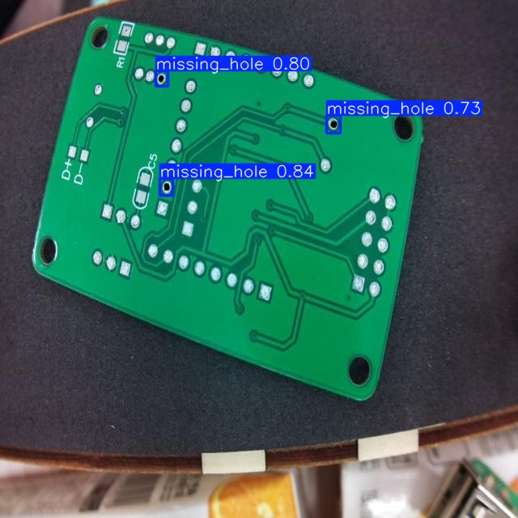
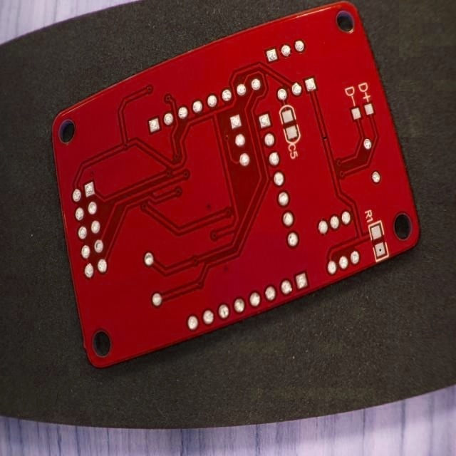
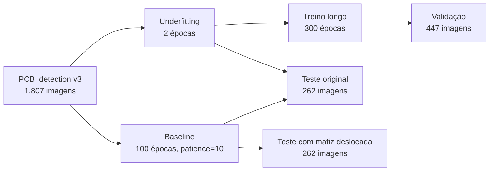
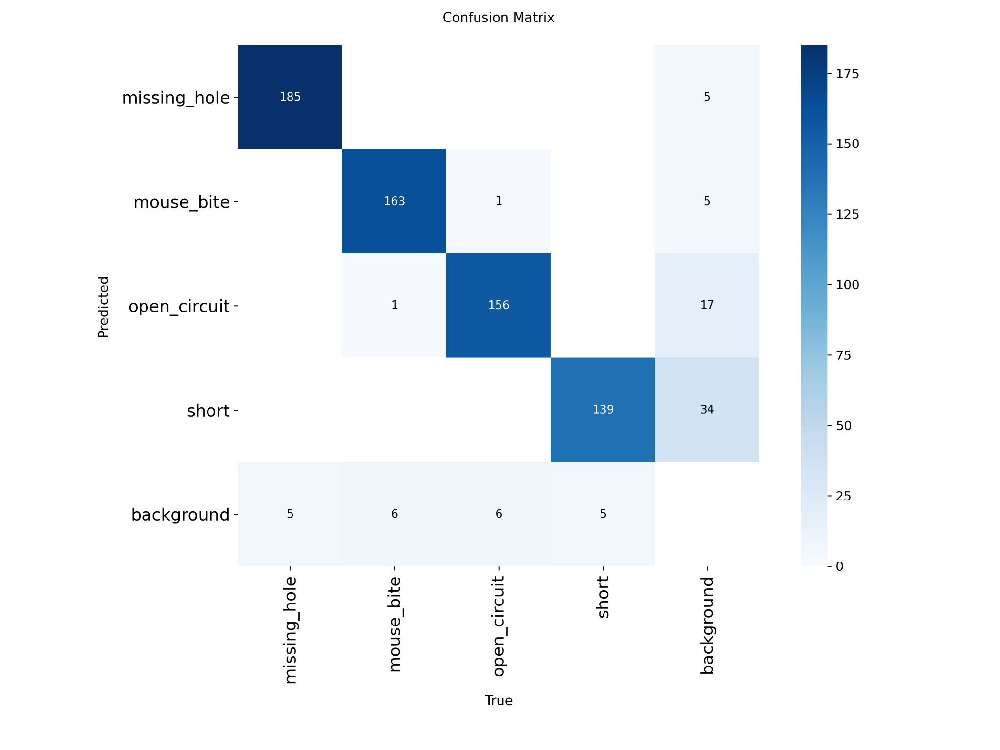

<div align="center">

# Hawkeye

**Detecção de defeitos em placas de circuito impresso com YOLOv8**

Análise de underfitting, overfitting e generalização fora da distribuição de treino

[](https://colab.research.google.com/github/davidmarianosantos/hawkeye-pcb-defect-detection/blob/main/hawkeye_pcb_detection.ipynb)


[Resultados](#resultados) · [Achado principal](#o-achado-principal-o-modelo-aprendeu-cor-não-defeito) · [Abordagem](#dataset-e-abordagem) · [Métricas](#análise-das-métricas) · [Reproduzir](#como-reproduzir) · [Relatório](docs/relatorio-tecnico.pdf)

<br>

<table>
  <tr>
    <td align="center" width="50%"></td>
    <td align="center" width="50%"></td>
  </tr>
  <tr>
    <td align="center"><sub><b>Teste original:</b> o baseline detecta três <code>missing_hole</code></sub></td>
    <td align="center"><sub><b>Matiz deslocada:</b> o mesmo modelo não detecta nada</sub></td>
  </tr>
</table>

</div>

## Resultados

| Cenário | Conjunto avaliado | mAP50 | Recall | Precisão |
|---|---|---:|---:|---:|
| Baseline (100 épocas, early stopping) | teste original (262 imagens) | 92,9% | 90,0% | 91,6% |
| Underfitting (2 épocas) | teste original | 46,1% | 31,4% | 75,3% |
| Treino longo (300 épocas) | validação (447 imagens) | 93,3% | 93,3% | 92,4% |
| **Baseline, imagens com matiz deslocada** | **teste alterado (262 imagens)** | **3,0%** | **6,7%** | **2,4%** |

<sub>O treino longo partiu dos pesos do modelo de 2 épocas, e as métricas dele são as da validação final do Ultralytics. Os demais cenários foram avaliados no conjunto de teste.</sub>

**Baseline por classe** (teste original, mAP50-95 geral de 50,0%):

| Classe | mAP50 |
|---|---:|
| `missing_hole` | 97,4% |
| `mouse_bite` | 97,3% |
| `open_circuit` | 89,1% |
| `short` | 88,0% |

## O achado principal: o modelo aprendeu cor, não defeito

> [!IMPORTANT]
> O mesmo modelo que marca **92,9%** de mAP50 no teste original cai para **3,0%** quando as placas mudam de verde para vermelho. Os rótulos e a posição dos defeitos continuam os mesmos.

Para testar a generalização, o conjunto de teste foi reprocessado com deslocamento de matiz no espaço HSV (+100 no canal H), o que transforma as placas verdes em vermelhas. Os rótulos ficaram os mesmos, porque a posição dos defeitos não muda.

Com confiança mínima de 0,25, o baseline não detectou nada em nenhuma das 262 imagens alteradas.

O dataset de treino só tem placas verdes. O resultado indica que a rede usou a cor da placa como atalho em vez da geometria do defeito (furos, cortes). Acurácia alta no teste não garante robustez: o conjunto de teste vem da mesma distribuição do treino, e não mede o que acontece quando essa distribuição muda.

O treino longo, por outro lado, não mostrou overfitting clássico: as métricas de validação continuaram altas e não houve divergência entre as curvas de treino e validação. Neste experimento, a falha de generalização veio do viés dos dados, não do número de épocas.

## Dataset e abordagem



### Dados

- [PCB_detection](https://universe.roboflow.com/object-defect-1xn3t/pcb_detection-kecsf) (Roboflow Universe), versão 3, público.
- 1.807 imagens: 1.098 de treino (61%), 447 de validação (25%) e 262 de teste (14%).
- Classes: `missing_hole`, `mouse_bite`, `open_circuit`, `short`.
- Sem pré-processamento nem data augmentation, de propósito, para observar o comportamento "puro" da rede.

### Modelo e treino

- YOLOv8n com transfer learning a partir dos pesos pré-treinados (`yolov8n.pt`).
- Baseline: 100 épocas, imagem 640, early stopping com `patience=10`.
- Underfitting: 2 épocas.
- Treino longo: 300 épocas.

**Ambiente:** Google Colab, GPU Tesla T4, Ultralytics 8.3.235, PyTorch 2.9.0+cu126.

### Pesos treinados

Versionados neste repositório. As células de treino do notebook são opcionais.

| Arquivo | Treino | Cenário |
|---|---|---|
| [`weights/baseline/best.pt`](weights/baseline/best.pt) | `hawkeye_v1` | Baseline |
| [`weights/underfit/best.pt`](weights/underfit/best.pt) | `hawkeye_v3Under` | Underfitting |
| [`weights/overfit/last.pt`](weights/overfit/last.pt) | `hawkeye_v2` | Treino longo |

## Análise das métricas

Precisão e recall foram escolhidos pelo custo operacional de cada tipo de erro numa linha de inspeção:

| Métrica baixa | Consequência na linha |
|---|---|
| Precisão | Falsos alarmes param a produção sem necessidade |
| Recall | Placas defeituosas passam e chegam ao cliente |

<p align="center">
  
</p>

Na matriz de confusão do baseline, a classe `short` teve 34 falsos alarmes: o modelo confundiu o fundo da placa com curto-circuito. Isso explica a precisão mais baixa dessa classe (83,8%).

O modelo de 2 épocas mostra o mesmo trade-off pelo lado oposto: precisão de 75,3% com recall de 31,4%. As poucas detecções que ele faz costumam estar certas, mas ele deixa passar cerca de dois terços dos defeitos.

## Como reproduzir

O notebook [`hawkeye_pcb_detection.ipynb`](hawkeye_pcb_detection.ipynb) foi executado no Google Colab. Depois de cada célula de treino, há uma célula que carrega os pesos já treinados de `weights/`, então dá para pular o treino.

### 1. Chave do Roboflow

O download do dataset precisa de uma chave de API do Roboflow. O notebook lê a chave nesta ordem:

1. variável de ambiente `ROBOFLOW_API_KEY`;
2. no Colab, o secret `ROBOFLOW_API_KEY` (ícone de chave na barra lateral, com acesso liberado para o notebook).

> [!WARNING]
> Nunca coloque a chave diretamente no código.

### 2. Executar

<details>
<summary><b>No Google Colab</b></summary>

<br>

Selecione um ambiente com GPU e rode, no início do notebook:

```python
!git clone https://github.com/davidmarianosantos/hawkeye-pcb-defect-detection.git
%cd hawkeye-pcb-defect-detection
```

Os caminhos dos pesos são relativos à raiz do repositório.

</details>

<details>
<summary><b>Localmente</b></summary>

<br>

```bash
git clone https://github.com/davidmarianosantos/hawkeye-pcb-defect-detection.git
cd hawkeye-pcb-defect-detection
pip install ultralytics roboflow jupyter
export ROBOFLOW_API_KEY="sua-chave"
jupyter notebook hawkeye_pcb_detection.ipynb
```

No notebook, pule as células `!pip install` se as dependências já estiverem instaladas.

</details>

## Estrutura do repositório

```
.
├── hawkeye_pcb_detection.ipynb   # notebook com todas as saídas
├── weights/                      # pesos dos três treinos
│   ├── baseline/best.pt
│   ├── underfit/best.pt
│   └── overfit/last.pt
└── docs/
    ├── relatorio-tecnico.pdf     # relatório completo
    └── img/                      # figuras do README
```

## Contexto acadêmico e autoria

Trabalho avaliativo da disciplina de Inteligência Artificial (DEC000068) da Universidade Estadual de Santa Cruz (UESC), Ilhéus, 2025.

O enunciado trazia um cenário industrial **fictício**, uma fábrica que inspeciona manualmente cerca de 2.000 placas por dia, e pedia uma análise de underfitting e overfitting. O cenário de negócio e o tema da análise vieram do enunciado.

| Equipe |
|---|
| Cibelle Sousa Rodrigues |
| David Júnio Mariano dos Santos |
| Laisa Pereira da França |

## Relatório técnico

O relatório completo, com a fundamentação teórica, a matriz de confusão e a discussão de cada cenário, está em [`docs/relatorio-tecnico.pdf`](docs/relatorio-tecnico.pdf).
